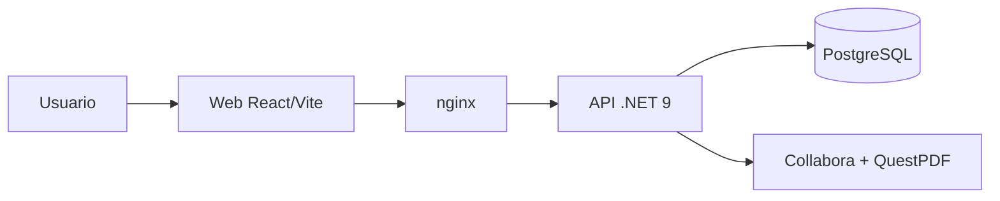

# BuenaTierra — Sistema de gestión integral para obrador

[](https://github.com/rufae/BuenaTierra/actions/workflows/ci.yml)
[](src/)
[](frontend/)
[](database/)
[](tests/)

Software de gestión para **obradores artesanos**: producción por lotes con
**trazabilidad completa** (alérgenos, consumo preferente, ingredientes),
automatización de lotes **FIFO**, preventa con reparto, facturación y
etiquetado de productos. Diseñado para el día a día real de un obrador:
mismo flujo que el papel, sin el papel.

## Características

- **Producción por lotes**: alta de lotes con ingredientes y alérgenos,
  asignación FIFO automática (con control de concurrencia verificado),
  caducidades y consumo preferente.
- **Trazabilidad punta a punta**: de la materia prima al producto entregado;
  etiquetas de producto editables (peso, lote, alérgenos) y generación de
  documentos PDF.
- **Preventa y reparto**: pedidos de clientes, rutas de reparto y albaranes.
- **Facturación**: series FAC/ALB, bases imponibles e IVA.
- **Multiusuario con roles**: Admin y Cliente (cuentas operativas de obrador
  y reparto), cambio de contraseña obligatorio en el primer acceso.
- **Seguridad**: contraseñas seed **aleatorias por instalación** (sin defaults
  en el código), JWT, configuración SMTP cifrada en reposo.

## Stack

| Capa | Tecnología |
|---|---|
| API | .NET 9 · Clean Architecture (Domain / Application / Infrastructure / API) |
| Web | React + Vite + TypeScript |
| Base de datos | PostgreSQL (esquema `database/init`) |
| Documentos | Collabora (edición) + QuestPDF (generación) |
| Despliegue | Docker Compose (db · api · nginx · collabora) |

## Arquitectura



Clean Architecture: `Domain` (entidades y reglas: lotes FIFO, IVA) →
`Application` (casos de uso) → `Infrastructure` (EF Core, persistencia) →
`API` (endpoints, auth, seed).

## Arranque rápido

```bash
cp .env.example .env          # define POSTGRES_PASSWORD y JWT_SECRET
docker compose up -d
# API en http://localhost:5001 · Web en http://localhost (nginx)
```

> Al arrancar, la API crea los usuarios iniciales (admin, obrador, repartidor)
> con **contraseñas aleatorias que aparecen una única vez en el log**
> (o fíjalas con `SEED_ADMIN_PASSWORD`, `SEED_OBRADOR_PASSWORD`,
> `SEED_REPARTIDOR_PASSWORD`). Todos deben cambiarlas en el primer acceso.

## Calidad

- **~100 tests** .NET (`xUnit`) con **Testcontainers** para la integración real
  contra PostgreSQL — concurrencia del ledger FIFO, aislamiento y reglas de negocio.
- **Frontend**: vitest + ESLint + TypeScript estricto.
- **E2E**: Playwright (flujo completo del obrador).
- **Carga**: k6 (ventas y concurrencia FIFO).
- **CI**: GitHub Actions (build, tests, lint, tipos y push de imagen).

## Estructura

```
├── src/                  # API .NET 9 (Clean Architecture)
│   ├── BuenaTierra.Domain
│   ├── BuenaTierra.Application
│   ├── BuenaTierra.Infrastructure
│   └── BuenaTierra.API
├── frontend/             # Web React + Vite + TS
├── database/init/        # Esquema y seeds de PostgreSQL
├── tests/                # Unit · Integration (Testcontainers) · E2E · load (k6)
└── docker-compose.yml    # db · api · nginx · collabora
```

## Licencia

Privado — todos los derechos reservados (pendiente de publicar bajo licencia
open source).
